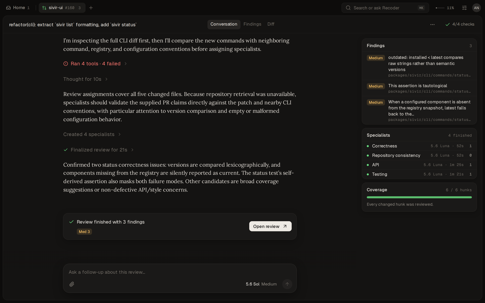

# Recoder

A self-hosted pull request reviewer.



## Run

```sh
bun install
bun run dev
```

The app opens at http://localhost:5180 and the server listens on port 3001. `bun run dev:web` runs the SvelteKit app (`apps/web`) in its place.

Or with Docker:

```sh
cp .env.example .env
docker compose up --build
```

The app opens at http://localhost:3000 and the server listens on port 3001. The image builds `PUBLIC_API_URL` into the app, so rebuild after you change it.

Configuration lives in [`.env.example`](.env.example).

The review pipeline is documented stage by stage for agents in [docs/review](docs/review/README.md).
